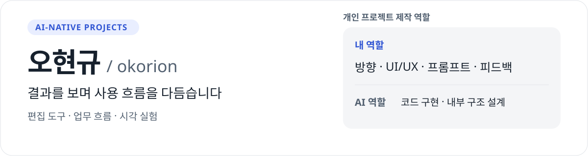

<picture>
  <source media="(prefers-color-scheme: dark) and (max-width: 600px)" srcset="./assets/hero-mobile-dark.svg" />
  <source media="(prefers-color-scheme: light) and (max-width: 600px)" srcset="./assets/hero-mobile-light.svg" />
  <source media="(prefers-color-scheme: dark)" srcset="./assets/hero-dark.svg" />
  <source media="(prefers-color-scheme: light)" srcset="./assets/hero-light.svg" />
  
</picture>

개인 프로젝트에서는 AI-native 방식으로 작업합니다. 저는 방향과 UI·UX를 정하고, 프롬프트를 구성하며 결과를 보고 수정 의견을 전달합니다. 코드 구현과 내부 구조 설계는 AI가 수행합니다.

[전체 프로젝트](https://okorion.github.io/?view=projects) · [소개](https://okorion.github.io/?view=about)

## 대표 프로젝트

### 01 — [Rust 3D Engine Lab](https://okorion.github.io/?project=rust-lab)

렌더링 비교 실험실에서 출발해 장면·재질·조명·애니메이션 편집과 프로젝트 저장·내보내기를 갖춘 3D 웹 스튜디오로 확장했습니다. Rust/wgpu와 Three.js WebGPU의 렌더링 비교도 제공합니다.

[데모 열기](https://rust-3d-engine-lab.vercel.app) · [만든 과정](https://okorion.github.io/?project=rust-lab)

### 02 — [정기 재무 보고서 검토 지원 도구](https://okorion.github.io/?project=report-review-tool)

엑셀 거래내역을 정리해 수정본과 확인할 항목을 보여 주고, 사람이 내용을 검토·확정하는 Windows 도구입니다.

[만든 과정](https://okorion.github.io/?project=report-review-tool)

### 03 — [Aether Studio](https://okorion.github.io/?project=aether-studio)

스크롤과 포인터 움직임에 따라 3D 장면이 이어지는 가상 스튜디오 웹사이트입니다.

[데모 열기](https://aether-studio-nu.vercel.app/) · [만든 과정](https://okorion.github.io/?project=aether-studio)

Ember Studio와 다른 결과물은 [전체 프로젝트](https://okorion.github.io/?view=projects)에서 볼 수 있습니다.

[공개 코드: Mermaid Sky Exporter](https://github.com/okorion/mermaid-sky-exporter) · [VizPort Studio](https://github.com/okorion/vizport-studio) · [LocalMesh Studio](https://github.com/okorion/localmesh-studio)

---

[학습 아카이브 — 이전 강의·기술 학습 기록](https://okorion.github.io/tech-blog/)
