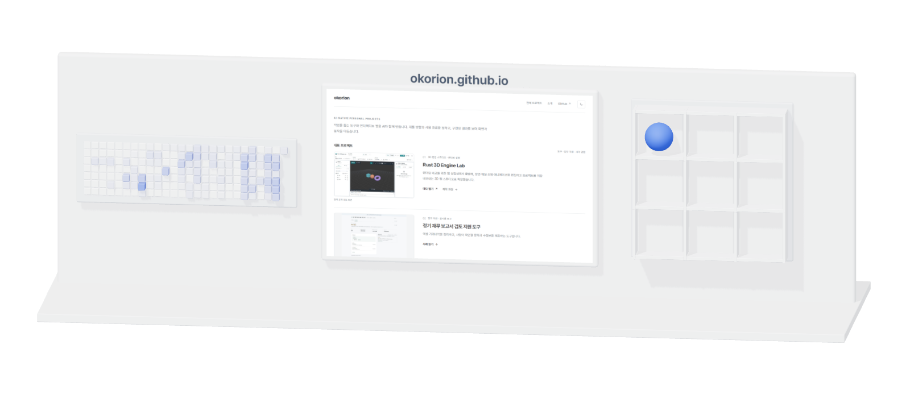

<a href="https://okorion.github.io/">
  <picture>
    <source media="(prefers-color-scheme: dark) and (max-width: 600px)" srcset="./assets/gallery/wall-mobile-dark.png" />
    <source media="(max-width: 600px)" srcset="./assets/gallery/wall-mobile-light.png" />
    <source media="(prefers-color-scheme: dark)" srcset="./assets/gallery/wall-dark.png" />
    
  </picture>
</a>

[포트폴리오 둘러보기 ↗](https://okorion.github.io/) · [오브젝트 남기기 +](https://github.com/okorion/okorion/issues/new?template=gallery.yml) · [README Gallery ↗](https://github.com/okorion/readme-gallery)
