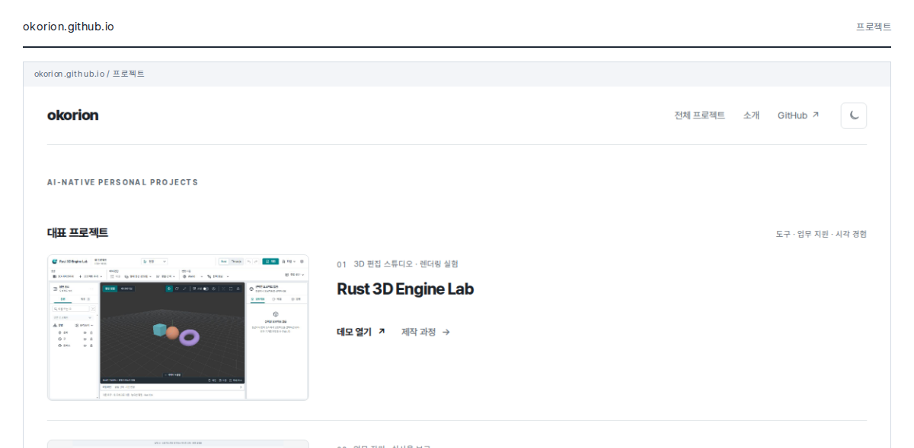
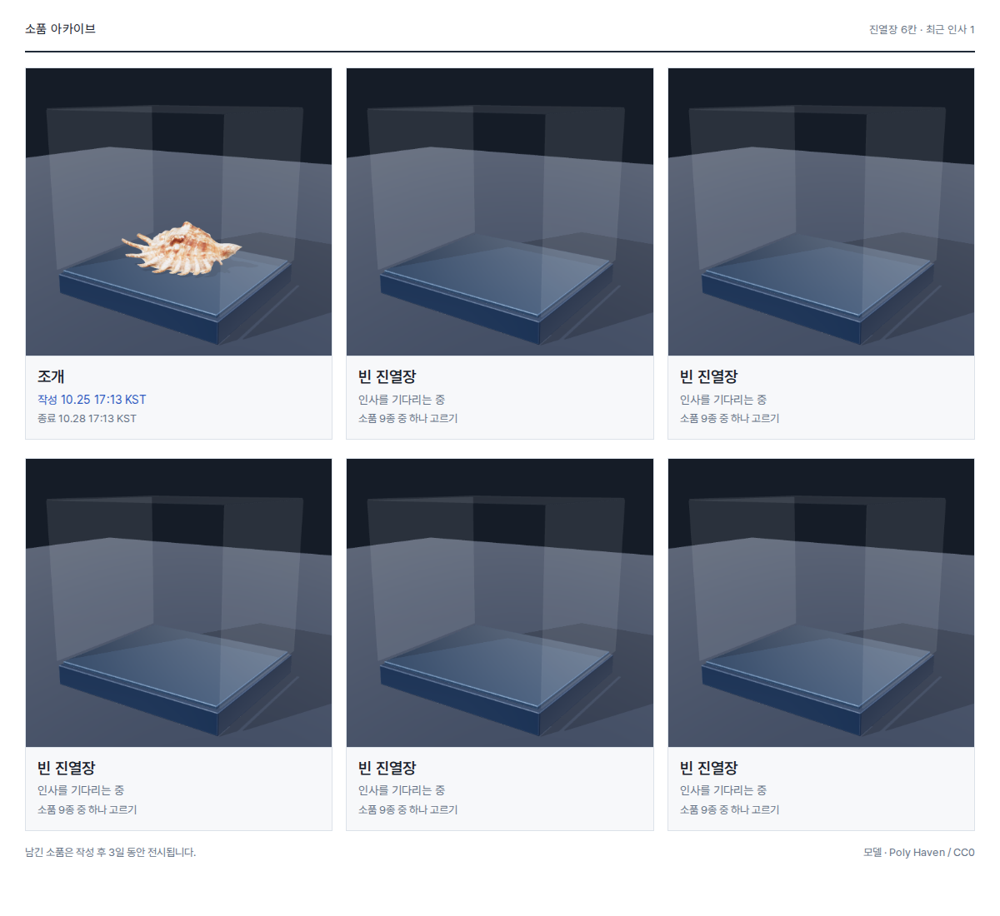

### 프로젝트

<a href="https://okorion.github.io/">
  <picture>
    <source media="(prefers-color-scheme: dark) and (max-width: 600px)" srcset="./assets/gallery/archive-portfolio-mobile-dark.png" />
    <source media="(max-width: 600px)" srcset="./assets/gallery/archive-portfolio-mobile-light.png" />
    <source media="(prefers-color-scheme: dark)" srcset="./assets/gallery/archive-portfolio-dark.png" />
    
  </picture>
</a>

[프로젝트 둘러보기 ↗](https://okorion.github.io/)

### 소품으로 인사 남기기

<a href="https://okorion-guestbook.ok-or-orion.workers.dev/">
  <picture>
    <source media="(prefers-color-scheme: dark) and (max-width: 600px)" srcset="./assets/gallery/archive-guestbook-mobile-dark.png" />
    <source media="(max-width: 600px)" srcset="./assets/gallery/archive-guestbook-mobile-light.png" />
    <source media="(prefers-color-scheme: dark)" srcset="./assets/gallery/archive-guestbook-dark.png" />
    
  </picture>
</a>

소품 9종 중 하나로 인사를 남겨 주세요. 최근 인사 6개를 작성 후 3일 동안 표시하며, 인사가 없는 진열장은 비워 둡니다.

[익명으로 소품 고르기 ↗](https://okorion-guestbook.ok-or-orion.workers.dev/) · [GitHub 방식으로 남기기 ↗](https://github.com/okorion/okorion/issues/new?template=gallery.yml) · [소품 출처·사용 안내](./docs/gallery.md)
