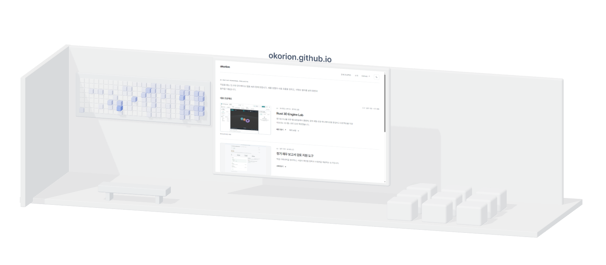
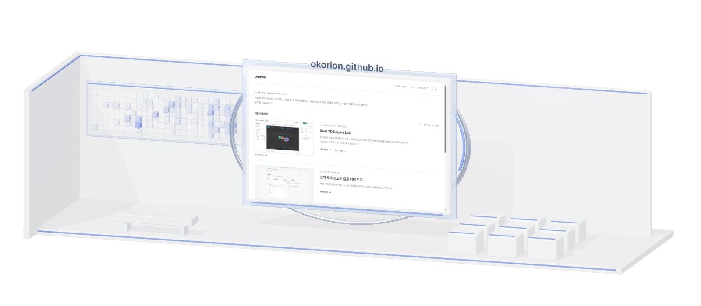
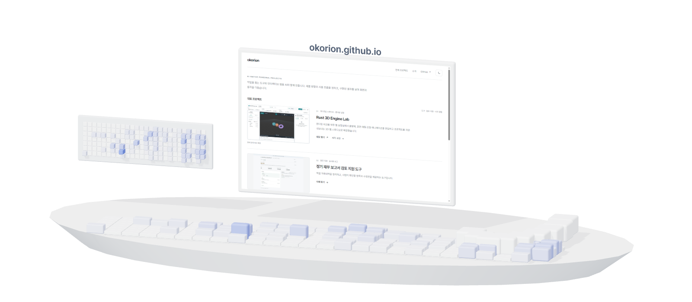
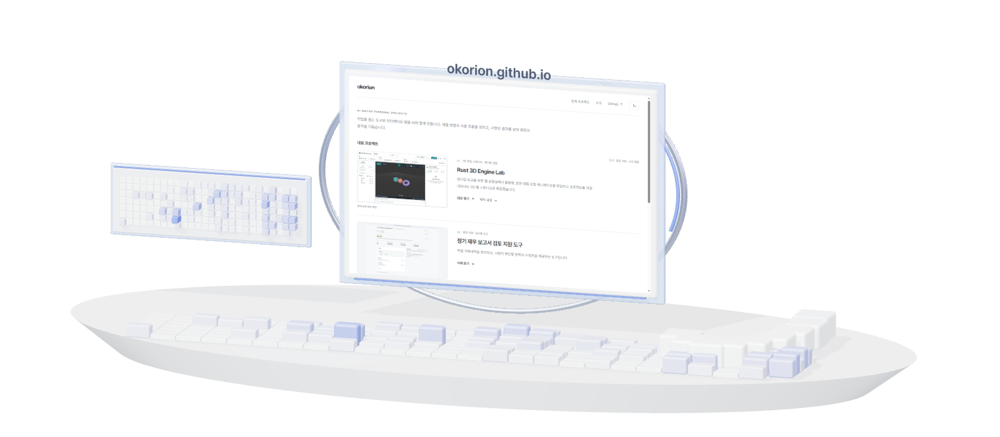
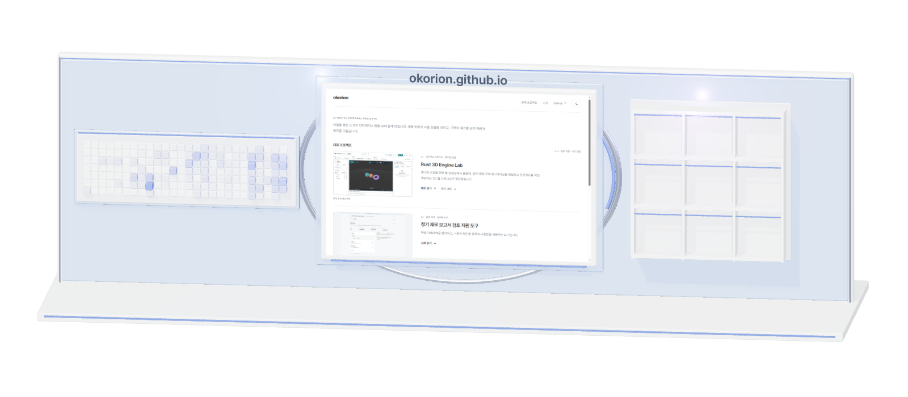
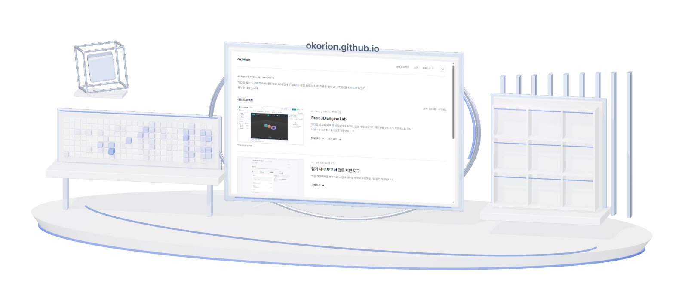

# README 디자인 비교

A·B·C 각각의 배치를 유지한 Simple / Advanced 6종과 별도 D 디자인입니다.

[교체 방법](gallery.md#디자인-교체) · [현재 프로필](https://github.com/okorion)

## A · Simple

<picture>
  <source media="(prefers-color-scheme: dark) and (max-width: 600px)" srcset="../assets/gallery/gallery-mobile-dark.png" />
  <source media="(max-width: 600px)" srcset="../assets/gallery/gallery-mobile-light.png" />
  <source media="(prefers-color-scheme: dark)" srcset="../assets/gallery/gallery-dark.png" />
  
</picture>

[밝은 화면](../assets/gallery/gallery-light.png) · [어두운 화면](../assets/gallery/gallery-dark.png) · [모바일](../assets/gallery/gallery-mobile-light.png)

## A · Advanced

<picture>
  <source media="(prefers-color-scheme: dark) and (max-width: 600px)" srcset="../assets/gallery/gallery-advanced-mobile-dark.png" />
  <source media="(max-width: 600px)" srcset="../assets/gallery/gallery-advanced-mobile-light.png" />
  <source media="(prefers-color-scheme: dark)" srcset="../assets/gallery/gallery-advanced-dark.png" />
  
</picture>

[밝은 화면](../assets/gallery/gallery-advanced-light.png) · [어두운 화면](../assets/gallery/gallery-advanced-dark.png) · [모바일](../assets/gallery/gallery-advanced-mobile-light.png)

## B · Simple

<picture>
  <source media="(prefers-color-scheme: dark) and (max-width: 600px)" srcset="../assets/gallery/island-mobile-dark.png" />
  <source media="(max-width: 600px)" srcset="../assets/gallery/island-mobile-light.png" />
  <source media="(prefers-color-scheme: dark)" srcset="../assets/gallery/island-dark.png" />
  
</picture>

[밝은 화면](../assets/gallery/island-light.png) · [어두운 화면](../assets/gallery/island-dark.png) · [모바일](../assets/gallery/island-mobile-light.png)

## B · Advanced

<picture>
  <source media="(prefers-color-scheme: dark) and (max-width: 600px)" srcset="../assets/gallery/island-advanced-mobile-dark.png" />
  <source media="(max-width: 600px)" srcset="../assets/gallery/island-advanced-mobile-light.png" />
  <source media="(prefers-color-scheme: dark)" srcset="../assets/gallery/island-advanced-dark.png" />
  
</picture>

[밝은 화면](../assets/gallery/island-advanced-light.png) · [어두운 화면](../assets/gallery/island-advanced-dark.png) · [모바일](../assets/gallery/island-advanced-mobile-light.png)

## C · Simple

<picture>
  <source media="(prefers-color-scheme: dark) and (max-width: 600px)" srcset="../assets/gallery/wall-mobile-dark.png" />
  <source media="(max-width: 600px)" srcset="../assets/gallery/wall-mobile-light.png" />
  <source media="(prefers-color-scheme: dark)" srcset="../assets/gallery/wall-dark.png" />
  
</picture>

[밝은 화면](../assets/gallery/wall-light.png) · [어두운 화면](../assets/gallery/wall-dark.png) · [모바일](../assets/gallery/wall-mobile-light.png)

## C · Advanced

<picture>
  <source media="(prefers-color-scheme: dark) and (max-width: 600px)" srcset="../assets/gallery/wall-advanced-mobile-dark.png" />
  <source media="(max-width: 600px)" srcset="../assets/gallery/wall-advanced-mobile-light.png" />
  <source media="(prefers-color-scheme: dark)" srcset="../assets/gallery/wall-advanced-dark.png" />
  
</picture>

[밝은 화면](../assets/gallery/wall-advanced-light.png) · [어두운 화면](../assets/gallery/wall-advanced-dark.png) · [모바일](../assets/gallery/wall-advanced-mobile-light.png)

## D · Pavilion

<picture>
  <source media="(prefers-color-scheme: dark) and (max-width: 600px)" srcset="../assets/gallery/pavilion-mobile-dark.png" />
  <source media="(max-width: 600px)" srcset="../assets/gallery/pavilion-mobile-light.png" />
  <source media="(prefers-color-scheme: dark)" srcset="../assets/gallery/pavilion-dark.png" />
  
</picture>

[밝은 화면](../assets/gallery/pavilion-light.png) · [어두운 화면](../assets/gallery/pavilion-dark.png) · [모바일](../assets/gallery/pavilion-mobile-light.png)
